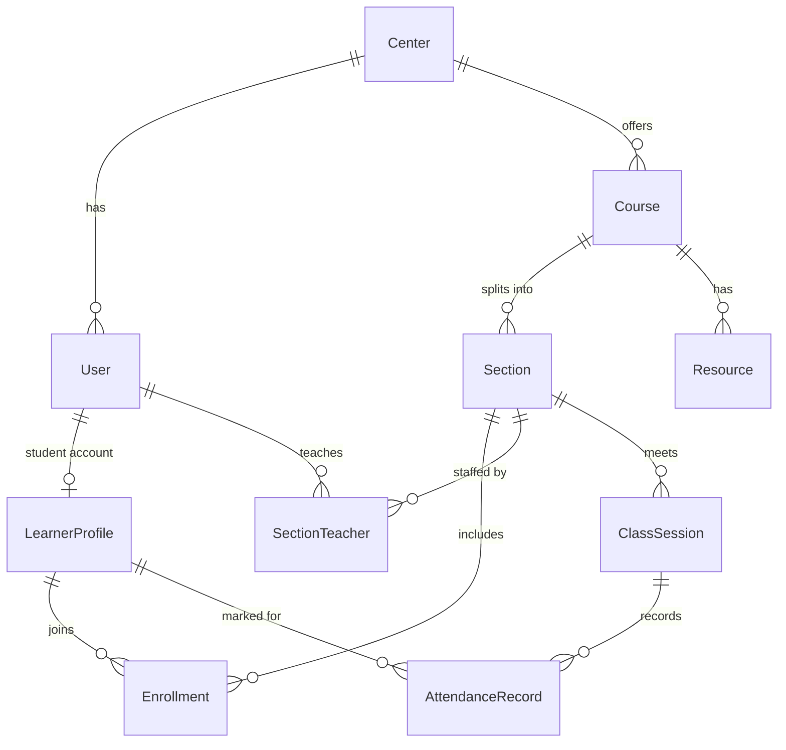
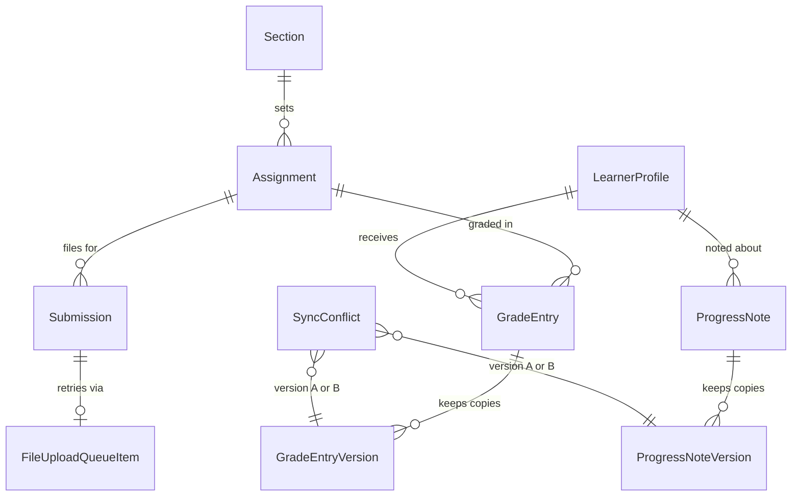
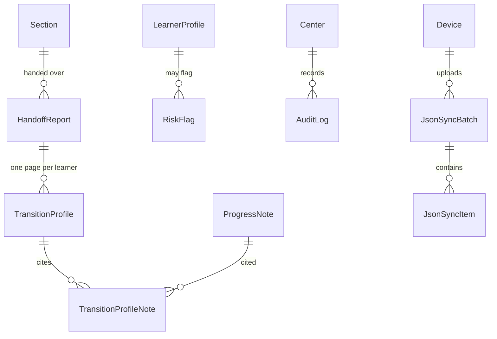

# Database

This database holds the Phase 1 records for one learning center: people, classes, attendance, grades, notes, and the bookkeeping needed to sync a phone that was offline.

The app talks to PostgreSQL through [Prisma](https://www.prisma.io/) 7.10. Prisma is the tool that turns `prisma/schema.prisma` into tables and into TypeScript queries. Prisma 8 was a release candidate when this was added, so the project stays on 7.10.

The connection string lives in `.env` under the name `DATABASE_URL`. That file is not committed. `.env.example` lists the name without a real password.

## What is stored, and what is not

A learner row stores a learner code, a first name or nickname, an age band, and the section they attend. A center can turn on two optional facts: gender (a short fixed list) and a phone number for the director. The phone table stays empty unless that center has switched the phone field on. The demo center has not.

These things are not columns, and the tests check that they stay absent:

- home address
- exact birth date
- identity-document numbers
- immigration or legal status
- a free-text box for family circumstances

An absence can use the reason “family circumstances,” but that is only a label. The database has nowhere to type the details. Progress notes and grade comments are for schoolwork. They are length-limited so they are a poor place to store a life story, and the screen that writes them later must say so.

Accounts are switched off, not deleted. A teacher who leaves keeps their old attendance and notes.

## Three ways a phone sends data

A version vector is a small scoreboard: each phone has a count of how many times it has saved that record. The app compares scoreboards. It does not trust the clock on the phone, because those clocks are often wrong.

| Kind of record | Examples | What happens offline | If two phones disagree |
| --- | --- | --- | --- |
| Append-only event | Attendance | The phone stores a new event with its own `clientEventId`. | They do not disagree. A correction is another event. The server keeps both. |
| Editable record | Grade, progress note | The phone reuses the same record id and bumps its own count on the version vector. | The server keeps both full copies, marks a conflict, and shows the copy it received later until a teacher chooses. |
| File upload | Homework photo | The photo waits in its own queue. It is not inside the JSON batch. | A retry uses the same `clientSubmissionId`, so the gradebook does not grow a second row. |

JSON sync is the compressed batch of attendance, grades, notes, and lesson progress. The file queue is a different table with no link to that batch. A slow photo must not block the attendance batch, and the database never stores the photo bytes. It stores the size, the MIME type (what kind of file it is), a checksum (a fingerprint of the bytes), and a private storage key. The key is not a public web link.

`syncedAt` means when the server received that row or that version. `deviceRecordedAt` and `recordedAt` are the phone’s clock, kept so a person can read them, not so the software can sort them.

## How the tables connect

A foreign key is a link the database refuses to break. An index is a shortcut for a search the app does often, such as “attendance for this session” or “open conflicts.”

## People and the center

### Center

One learning center. The demo row is named Demo Learning Center and its code is `DEMO`. The timezone is only for showing the timetable later. Saved times stay in UTC, which is a shared clock that does not shift with a phone’s settings.

The center also stores the starting risk levels from the requirements (Watch at 40, High at 70) and the export rule that a group smaller than 5 learners is shown as “<5”. Those are settings, not personal data.

### CenterOptionalField

One row per optional fact, per center, with an on/off switch. The demo center allows gender and does not allow a phone number. A database rule rejects a gender or phone row when the switch is off.

### User

A login for a student, teacher, center director, or admin. `active` is the on/off flag. Turning it off sets `deactivatedAt` and keeps the row.

Staff have an email and a password hash. Learners do not. A hash is a scrambled form of the secret that cannot be read back. This project uses Node’s built-in `scrypt`. Sign-in checks that same format. Maintained alternatives are `bcrypt` and `argon2`. Argon2 needs a native add-on, so the project stays with scrypt unless the hashes are deliberately rotated.

Staff sign in with email and password. Learners sign in with a learner code and a 4-digit PIN. The PIN is hashed the same way. The PIN itself is not stored. Five wrong tries lock that account for 15 minutes. Unknown emails and unknown learner codes get the same message as a wrong password, so the form cannot be used to discover which accounts exist.

A signed-in browser gets a sealed cookie from the `iron-session` library. The cookie holds a session id. The session row can be revoked on sign-out, so a copied cookie stops working. A session ends after 8 hours, or after 30 minutes with no use. Deactivated accounts cannot sign in.

The demo password for every staff account is `demo-password`. The demo PIN for every learner is `1234`. They are for this fake center only.

### AuthSession

One row per sign-in. `revokedAt` is set on sign-out, when the session goes idle, when the 8 hours are up, and when a password or PIN is changed.

### LoginThrottle

A counter for failed sign-ins. The key is a hash of the attempted email, learner code, or network address, not the raw value. Five failures set `lockedUntil` 15 minutes ahead.

### DeviceHandover

A short note written by staff when a shared phone still has records that have not been sent. The records stay on the phone. This table does not contain them, and it does not contain a PIN or a password.

### LearnerProfile

The learner’s code (`LNR-0001` in the demo), nickname or first name, age band, and PIN hash. The age band is a range such as 12–14, never a birthday. The center id is repeated here, on purpose, so a learner query does not have to join the account table. A database rule keeps it equal to the account’s center.

### LearnerOptionalGender and LearnerOptionalContact

Split out so a dump of the main learner table does not include a phone number. Gender is one value from a fixed list. The phone table is the only place a phone number can go, it is meant for the director, and it must never be exported. The demo seed inserts no phone numbers.

### Device

A phone or laptop that syncs. Its id is the name used inside a version vector. The demo has a morning kiosk phone, an afternoon kiosk phone, and an office laptop.

## Classes

### Course

A subject for one year and semester. The demo course is “Demo English and Number Sense” for 2026, semester 1.

### Section

A group inside a course. The demo has Morning Group and Afternoon Group, with 15 learners each.

### Enrollment

The link between a learner and a section, with a start date and a status: active, withdrawn, or completed. A learner can appear only once in the same section. Withdrawing requires a withdrawn date. The other statuses do not have one.

### SectionTeacher

Which teacher is responsible for a section, and between which dates. An empty end date means they are still assigned. The demo leaves Teacher One and Teacher Three on the morning group. Teacher Three’s afternoon assignment ends on 5 October 2026, and Teacher Two starts the next day. The database allows only one open assignment for the same teacher and section.

### Resource

Something attached to a course, or to one section. Types match the requirements: PDF, text, textbook link, audio, video link, and web link. Links store a URL. PDF and audio store a private storage key, size, MIME type, and checksum. The file itself is not in the database. A database rule checks that each type has the matching fields, and that a section-only resource belongs to the same course as that section.

### ClassSession

One meeting on the timetable: in person, live online, or pre-recorded. Live sessions may store a join link. Cancelled sessions stay in the table so the risk score can ignore them instead of treating them as absences. The demo has twelve Monday/Thursday sessions for each section across several weeks. One of those sessions is cancelled. One is live, with a fake `example.com` link. One is pre-recorded and points at a resource.

## Attendance

### AttendanceRecord

One tap, or one correction. The row is append-only: the database rejects updates, and it rejects deletes unless a local demo reset turns on a special switch. That switch still does not allow edits.

| Field | Meaning |
| --- | --- |
| `clientEventId` | Id from the phone. Sending the same id again must not create a second row. |
| `learnerId`, `sessionId` | Who, and which meeting. |
| `status` | Present, absent, late, or excused. |
| `reasonCode` | Optional coarse reason. Present cannot have one. |
| `deviceId` | Which phone saved it. |
| `recordedAt` | Phone clock. Not used to order corrections. |
| `syncedAt` | When the server received it. This orders corrections. |
| `createdOffline` | True when the phone saved it before it could reach the server. |

The demo includes one correction. The first event says absent and its phone clock is two days ahead. The second says present. The server received the present mark later, so that is the later correction even though the phone clock looks earlier.

## Grades, files, and notes

### Assignment

A task with a maximum score. The kind is Paper (a mark, no file), Digital (a file the teacher grades later), Both (a paper mark now and a digital file later), or an in-class paper exam. Both is its own kind. It is not stored as Digital. Existing in-class exam rows stay. Each demo section has four: a homework, a quiz, a photo homework, and a midterm. The gradebook shows every kind in one table. The mark is still a `GradeEntry`. A file upload stays a separate queue.

### GradeEntry

The mark the gradebook shows now. The `id` is created on the phone the first time the mark is saved, and every later edit of that same mark uses the same id.

It carries the same sync fields as a progress note:

- `deviceId`
- `versionVector`
- `deviceRecordedAt`
- `syncedAt`
- `createdOffline`

There is one current mark per learner per assignment. A short academic note is allowed. It is not a place for family details.

### GradeEntryVersion

A full copy of a mark each time one is saved, including both sides of a conflict. These rows are append-only. `preservedFromConflict` is true when the copy exists because two phones disagreed.

The demo has one open grade conflict. One phone saved 16. The office laptop saved 14. The laptop copy reached the server later, so the gradebook shows 14, and both copies remain.

### Submission

Metadata for one digital homework file. `clientSubmissionId` is the phone’s id for that upload. A retry with the same id and the same size, type, and checksum reuses this row. A retry with different details is refused. `uploadState` is queued, uploading, stored, or failed. The private `storageKey` is an opaque cupboard path, not a public web address and not the file itself. The checksum, size, and MIME type are the claim made at the start. The server marks the row stored only after it has read the stored bytes, checked the size, and calculated the SHA-256 itself. There is no column for the file bytes.

The demo checksums are the SHA-256 fingerprint of a short fake label, not of a real photo. SHA-256 is a standard fingerprint function built into Node. The four demo rows are photo metadata for the morning photo homework. Three say stored. One is still queued.

### FileUploadQueueItem

The retry line for those files. It points at one submission and tracks attempts and a short error code. It does not point at a JSON sync batch. The gradebook can show “queued” without reading this table. The worker that retries uploads can read this table without mixing photos into the attendance batch.

### LessonProgress

Whether a learner finished a class session: not started, in progress, or completed. A completed row must have a completion time. The others must not. This is a status flag, not a version-vector record. The requirements treat grades and progress notes as the editable records that can conflict. The optional section checklist is deferred until an offline update rule exists for two phones changing the same learner and session.

### ProgressNote

A teacher’s academic note, plus skill-gap tags: reading, writing, speaking, number sense, or one center-owned custom tag. New saves store that tag’s id. Older rows keep their free-text `customSkillLabel`, including the synthetic “map reading” label, and leave the tag id empty. A deactivated tag stays readable on those notes and cannot be chosen for a new save. The label is not copied into `AuditLog`.

The sync fields match `GradeEntry` exactly, including the stable `id`. The demo includes one open note conflict with the same shape as the grade conflict: two preserved copies, and the gradebook-style current row matches the copy the server received later. The phone clock on that shown copy is the earlier clock, on purpose.

### ProgressNoteVersion

Append-only history for notes. Same sync fields as `GradeEntryVersion`, plus the note text and skill tags.

## Handoff, risk, and audit

### HandoffReport

The section pack created when a teacher is deactivated or a section is reassigned. It points at the outgoing teacher, the incoming teacher when there is one, and the person who should read it (the incoming teacher, or the director if nobody has been assigned).

The demo includes one report for the afternoon group, dated the day Teacher Two takes over from Teacher Three. The app that builds this automatically is not written yet. The seed writes one report so the tables can be seen, using counts from the fake attendance and grades.

### TransitionProfile

One learner’s page inside that report. The requirements call this the Student Transition Profile. It stores counts and a trend label, not a copied essay. Notes stay in `ProgressNote` and are linked, so a later reader opens the real note.

The seed’s trend label compares the first two scores with the last two. That is only so the demo numbers have a rule you can check. The dashboard’s official Improving / Steady / Declining rule is in docs/DASHBOARD_METRICS.md. The seed label is not that rule.

### TransitionProfileNote

The link between a transition page and the notes that were included. A link table exists so the report does not paste note text into a second place.

### RiskFlag

A suggested check-in for a director. It stores a score, a level, the reason codes, and the numbers that were used. It does not store a name inside the score. The row points at the learner so the director’s screen can show a nickname. The Python risk service, which is not built yet, is supposed to receive only a learner code and numbers.

The seed does not invent scores. The requirements say each indicator is scaled from 0 to 1, and that scaling rule is not defined yet. Empty is more honest than a made-up score. Levels, dismiss reasons, and the “check-in done” status are already in the table. A dismissed flag must have a short reason from a fixed list. There is no free-text family field on this row either.

### AuditLog

Append-only list of who viewed or changed grades, notes, handoff reports, risk flags, exports, and related records. `metadata` may hold ids and field names. It must not hold names, note text, learner codes, or custom tag labels. A progress-note view stores `{ "source": "online" }` or `{ "source": "offline", "clientEventId": "..." }`. `at` is the server time. An offline view’s phone clock is not copied into this row. Opening the teacher records list does not record a view and does not send the note text to the phone. A view is recorded when one note is opened. Reloading that page needs a connection: the phone does not keep a copy of the page, so a fresh load cannot show notes while the connection is down. Note text from a note already opened stays in that open page's memory only. It is not written into the phone's view queue. The seed writes five “account created” rows whose metadata is only `{ "source": "synthetic-seed" }`.

## Sync bookkeeping

### SyncConflict

One clash between two saved versions. `state` is open or resolved. `resolution` is empty while it is open, and otherwise says the teacher kept the later-received copy, kept the other copy, or merged them.

A database rule requires both preserved versions, and requires them to be the same kind of record. A grade conflict points at two `GradeEntryVersion` rows and at the parent grade. A note conflict points at two `ProgressNoteVersion` rows and at the parent note. The other pair of columns stays empty. `shownGradeVersionId` or `shownNoteVersionId` is which preserved copy the screen shows meanwhile. It has to be one of the two copies.

### JsonSyncBatch and JsonSyncItem

One compressed JSON upload, and the records inside it. Attendance, grades, progress notes, and lesson progress can be in the batch. File uploads cannot. `clientMutationId` plus the device id is unique, so a retry does not apply the same save twice. The demo stores two small batches, one per kiosk phone, each with two attendance items already marked applied. The compressed size is a stand-in number. The gzip bytes are not stored.

## Demo data

All of it is fake.

| Item | Demo value |
| --- | --- |
| Center | Demo Learning Center (`DEMO`) |
| Admin | `admin@demo.invalid` |
| Director | `director@demo.invalid` |
| Teachers | `teacher.one@demo.invalid`, `teacher.two@demo.invalid`, `teacher.three@demo.invalid` |
| Staff password | `demo-password` |
| Learners | Demo Learner 01–30, codes `LNR-0001`–`LNR-0030` |
| Learner PIN | `1234` |
| Sections | Morning Group and Afternoon Group |
| Calendar | Mondays and Thursdays for 12 sessions, one cancelled |

Emails use `.invalid`, which is a reserved ending that does not deliver mail.

Re-running the seed deletes and rebuilds the `DEMO` center only. The seed does that in fifteen transactions, one after another. Reset is first. It turns on `app.allow_demo_reset` for that transaction only, so the append-only tables can be cleared. The switch ends when Reset commits. The later transactions insert the replacement rows and do not set the switch. Application code must not set that switch.

## How to look at it

This computer did not have PostgreSQL installed. Local development uses Prisma’s own Postgres server, started with `npx prisma dev`. It speaks the normal Postgres protocol. A hosted database for a real center is the same migrations with a different `DATABASE_URL`. Prisma’s local server currently names the database `template1`. That name is only a local quirk. A hosted database should use a normal name such as `open_lms_refuge`.

1. Start the local database: `npx prisma dev --detach --name open-lms-refuge`
2. Run `npx prisma dev ls` and copy the TCP address into `.env` as `DATABASE_URL`. Copy the shadow address into `SHADOW_DATABASE_URL`. The shadow database is a scratch copy Prisma uses while checking migrations. A normal PostgreSQL install can leave `SHADOW_DATABASE_URL` unset.
3. Create the tables: `npx prisma migrate dev`
4. Load the fake data: `npx prisma db seed`
5. Open the tables: `npx prisma studio`
6. Run the checks: `npx vitest run tests/phase1-schema.test.ts`

In Prisma Studio, open `attendance_records` and search for `demo-att-morning-2-4`. You should see two rows for the same learner and session. Then open `sync_conflicts`. You should see two open rows, each pointing at two different version ids.

The risk service, the login screens, and the sync engine that writes these tables from a phone are not part of this step. The tables are the contract those pieces will use.
