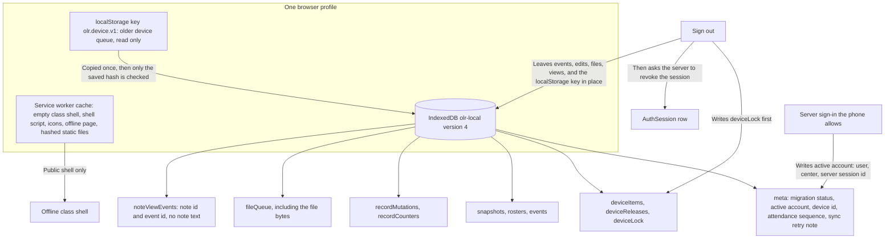
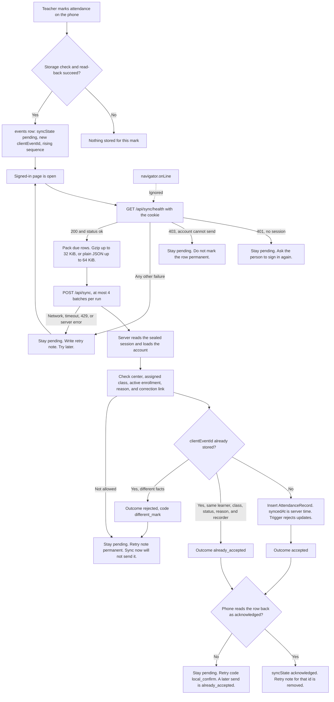
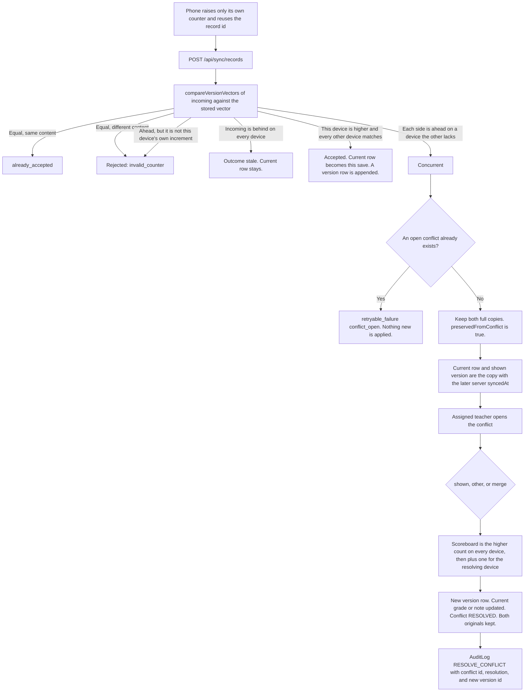
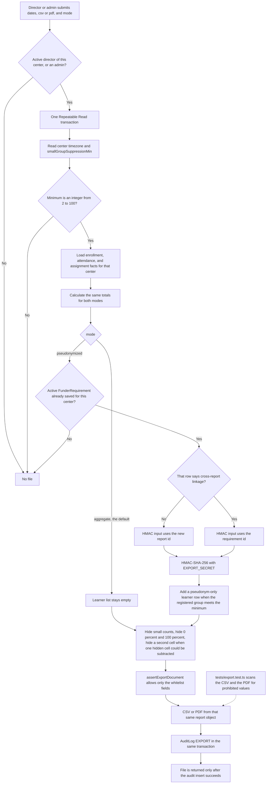

# Architecture

This page describes the system that is built on `main` at the start of Day 18 (commit `0d2acd0`, 2026-11-16). It was checked against the Prisma schema, the phone storage code, the sync and export modules, and the tests named under each diagram.

A feature that appears in `docs/PRD.md` is included here only when the code does it. Planned work is named as planned. The table guide in `docs/DATABASE.md` still explains each table. The three diagrams on that page are a subset. This page is the full picture.

IndexedDB is the browser database used for structured rows and file bytes. A version vector is a scoreboard of how many times each phone has saved one grade or one note. HMAC is a keyed fingerprint: the same input always produces the same output, and the output cannot be rebuilt without the secret key.

## What is implemented

- Phone storage in IndexedDB database `olr-local`, version 4, plus a read-only localStorage backup of the older device queue.
- Offline attendance that stays on the phone until the server accepts it, with retries and idempotent resends.
- Version-vector comparison for grades and progress notes, with human conflict resolution and an audit row.
- A server-side grant export with a field whitelist, HMAC pseudonyms, small-group suppression, CSV, and PDF.
- PostgreSQL tables from `prisma/schema.prisma`, including append-only attendance.

## What is not implemented

- Quiz answers. The requirements list them as Phase 2. There is no quiz model and no quiz sync.
- A phone workflow for lesson completion. The `LessonProgress` table and the `LESSON_PROGRESS` sync label exist. Seed data writes rows, and handoff reports can read them. No application path saves lesson progress from a phone.
- A screen for creating, editing, or turning off a `FunderRequirement`. The table, the server function `approveFunderRequirement`, and the export check for an active row exist. The Export page can only choose a row that is already stored. `docs/future-improvements.md` records the missing screen.
- A live Cloudflare R2 bucket. The file queue and the server checks are built. `docs/STORAGE.md` says the bucket has not been created. If the storage settings are empty, the app reports that file storage is unavailable.
- Encryption of IndexedDB or localStorage. The storage comments say the rows are readable in the browser's storage tools.

## Diagram 1 — Local storage and account isolation

One browser profile holds three different stores. They are not encrypted. A lock hides the class list on screen. It does not scramble or remove the saved rows.

### Where each kind of data lives

| Store | What is saved | How it is tied to a person |
| --- | --- | --- |
| Service worker cache | The empty class shell at `/kiosk-shell`, `/kiosk/shell.js`, the manifest, `/offline.html`, the two icons, and hashed files under `/_next/static/` | No learner names, attendance, cookies, or signed-in pages. `lib/device/precache-allowlist.mjs` refuses anything else. |
| localStorage `olr.device.v1` | The older phone queue: a lock, practice items, and release notes | Each item carries `userId` and `centerId`. This version of the app only reads the key. It does not write it and does not delete it. |
| IndexedDB `meta` | Bookkeeping | `activeAccount` stores `userId`, `centerId`, and `authSessionId`. The retry note key is `sync:` plus the center id and user id. |
| IndexedDB `events` | Attendance marks | `centerId`, `userId`, `localDeviceId`, section, class session, and learner. The `byOwner` index is `centerId` plus `userId`. |
| IndexedDB `snapshots` and `rosters` | The class the server already allowed, plus nicknames, learner codes, and the mark already on the server | Same owner fields. A roster is for one section and one class session. |
| IndexedDB `recordMutations` | Grade and progress-note edits, with a version vector | `centerId`, `userId`, and `localDeviceId`. |
| IndexedDB `fileQueue` | Homework file bytes and their status | `centerId`, `userId`, `learnerId`, and `localDeviceId`. |
| IndexedDB `noteViewEvents` | A receipt that a note was opened | `centerId`, `userId`, and `localDeviceId`. The note text is not in the row. |
| IndexedDB `deviceLock` | The shared-phone lock | `userId`, `centerId`, `lockId`, and, on a current lock, `authSessionId`. |

`localDeviceId` is an id this browser created. It is not a hardware serial number. It is also the id the server stores in the `Device` table when the phone first syncs.

The migration from localStorage into IndexedDB uses three states: `none`, `pending`, and `verified`. Only `verified` may be used. The two stores cannot be saved in one step, so the copy is written, read back, and marked verified only when it matches. A crash leaves the previous status in place. If the localStorage text changes after verification, the phone stops. New attendance, grades, notes, files, and locks are written only in IndexedDB after that point.

### Sign-in and sign-out

Staff and learners sign in on the server. The browser cookie, sealed with `iron-session`, holds the `AuthSession` id. The server session ends after 8 hours, after 30 minutes without a page load, or when `revokedAt` is set. Those clocks use the server time.

The phone also keeps a copy of that session's `lastSeenAt` and `expiresAt` on the class snapshot, plus the server clock and the phone clock at the moment the class was loaded. The offline screen uses the difference between those two clocks so a phone that was already wrong by a fixed amount can still show the class. The code in `lib/device/offline-decisions.ts` says this comparison is a convenience. Moving the phone clock later makes the check unreliable. The server session is the sign-in that actually ends.

Sign-out order, from `performPhoneSignOut`:

1. The phone writes a `deviceLock` row. Pending marks, grade edits, files, and note-view receipts stay where they are.
2. The class list is hidden.
3. Only after the lock write succeeds, the phone calls `POST /session/revoke`.
4. If that call fails, the lock remains and the message says the server sign-in will end when the phone can reach it. The waiting marks stay.

While the lock is present, `visibleItems` returns an empty list, including for the owner, until the lock is cleared. A second person is blocked when the locked account still has waiting items and nobody has written a release for that lock. The same account can clear the lock by signing in with a new server session. The same account with the same server session stays locked, including when the revoke call failed offline.

A staff member can write a handover note. Locally that is a `deviceReleases` row pointing at the lock id. On the server it is a `DeviceHandover` row with a short reason, an item count, and a device label. The note does not contain the records, a PIN, or a password. The records remain under the account that wrote them.

### What sign-out removes, keeps, and locks

| Item | On sign-out |
| --- | --- |
| Class list on screen | Hidden as soon as sign-out starts. A failed lock does not claim that sign-out finished. |
| IndexedDB attendance, grades, notes, files, note-view receipts, and practice items | Kept. The lock write touches the lock row. |
| localStorage `olr.device.v1` | Kept. The migration code never deletes it. |
| Server session | Revoked only when `POST /session/revoke` succeeds. A copied cookie stops working after `revokedAt` is set. |
| Rows for another account in the same browser | Kept. Reads are filtered by `centerId` and `userId`. The database file still contains them. |

Browser storage can still be removed by the browser itself. A save is reported only after a storage check and a read-back. If persistence is denied, or there is not enough free space, the attendance save says the mark was not stored. A granted persistence promise still does not mean the browser can never delete IndexedDB. That limit is stated in `lib/device/offline-decisions.ts` and `lib/device/local-records.ts`.

### Local status words

Attendance events store `syncState` as `pending` or `acknowledged`. A refused or failed send stays `pending`. The retry note in `meta` says whether it will be tried again.

Grade and note edits use `pending`, `acknowledged`, `conflict`, `stale`, or `rejected`. Homework files use `queued`, `uploading`, `awaiting_confirmation`, `failed`, or `submitted`. Note-view receipts use `pending`, `acknowledged`, or `rejected`.

Checked by `tests/local-db.test.ts`, `tests/stage6-shared-device.test.ts`, `tests/local-record-edits.test.ts`, `tests/note-view-local.test.ts`, and `tests/learner-files.test.ts`.

## Diagram 2 — Offline attendance synchronization

An attendance row on the phone is either waiting or confirmed. Failure is recorded beside the row, in the retry note. The row is not deleted in either case.

### States

| What a person can observe | What is stored |
| --- | --- |
| The mark was not stored | No event row. |
| Saved on this phone, waiting to send | `syncState` is `pending`. There may be no retry note yet. |
| Waiting to try again | Still `pending`. The retry note has `attempts`, `nextAttemptAt`, and `lastCode`. |
| Refused | Still `pending`. The retry note has `permanent: true`. The row stays on the phone. |
| Confirmed by the server | `syncState` is `acknowledged`. |

There is no `failed` value on an attendance event. The words above are the implemented distinction.

### Rules that keep a retry safe

- The upload runs only while a signed-in page is open. `lib/sync/trigger.ts` starts one attempt, listens for the browser online signal, and may schedule one wait. It does not poll forever, and it stops when the page is gone. The online signal only wakes the run. The health request decides whether the server was reached.
- The server answers 401 when the session is missing and 403 when the account cannot send. Both leave the row pending. A 403 is not treated as a permanent refusal of that one mark. A later 401 or 403 on the upload itself uses the same two outcomes.
- One run at a time. A second tap joins the run already in progress.
- Automatic retries stop after 6 attempts. The wait is full jitter from 0 up to a cap that starts at 2 seconds and doubles, never past 5 minutes. A stored wait longer than 5 minutes is treated as due, because phone clocks jump. Sync now may retry a non-permanent failure after the cap. A permanent refusal stays on the phone.
- The batch includes only pending rows for the signed-in user, center, and this browser's device id. Practice rows are held back and are never uploaded as attendance. Acknowledged rows are not sent again. A correction waits until the earlier local row is confirmed or is earlier in the same list.
- The server stores `clientEventId` as a unique key. The same id with the same learner, class, status, reason, and recorder is `already_accepted`. The same id with different facts is `different_mark` and is not written twice. A unique-key race reads the existing row and uses that same rule.
- The JSON sync item also uses `deviceId` plus `clientMutationId`. For attendance, that mutation id is the `clientEventId`.
- A correction is a new row. The database trigger `attendance_records_append_only` rejects updates. It rejects deletes unless the local demo reset has set `app.allow_demo_reset` for that transaction. Application code does not set that switch.
- The current mark for reports is the one with the latest server `syncedAt`, then `createdAt`, then id. `recordedAt` is the phone clock and is not the order.
- Reasons are accepted for Absent and Excused only. Present and Late cannot carry a reason in the application. The closed list is Illness, Family care, Transport or cost, Family circumstances (details not recorded), and Unknown.

Checked by `tests/sync-attendance.test.ts`, `tests/lms-attendance.test.tsx`, `tests/sync-database-failure.test.ts`, and the retry tests that import `lib/sync/retry.ts`.

## Diagram 3 — Version-vector conflict resolution

Attendance does not use this diagram. Attendance is append-only, so two phones cannot overwrite one attendance row. Grades and progress notes are editable. Each save carries a version vector. The phone clock is stored as `deviceRecordedAt` so a person can read it. Comparison never uses that clock.

A vector is a JSON object. Each key is a device id. Each value is that device's save count for this one record. A missing key means 0. A stored vector drops counts of 0. At most 16 devices are accepted. Counters are zero or a positive safe integer.

`compareVersionVectors` returns one of four results:

- `dominates`: the left vector is greater than or equal on every device and greater on at least one.
- `dominated`: the left vector is behind.
- `equal`: every device count matches.
- `concurrent`: each side has a count the other does not have.

An ordinary save is accepted only when it is this phone's own increment: its own count went up, and every other device's count is unchanged. A phone that raises another phone's count is rejected. The first save may mention only the phone that saved it.

Example from the tests: phone A saved `{A: 1}` and phone B saved `{B: 1}`. Each side has an edit the other never saw, so the result is concurrent. The server keeps both copies. The copy it received later, by `syncedAt`, is the one the gradebook shows. The teacher then resolves it. The merged scoreboard is `{A: 1, B: 1}`, and the resolving device's count becomes 1, so the stored vector is `{A: 1, B: 1, C: 1}` when the resolver is device C. A vector sent by the browser for the resolution is ignored. The server builds that scoreboard itself.

If the browser cannot name itself, the server uses one stable device id derived from the center id and the label `Server conflict resolution`. The count still moves forward.

The teacher chooses the shown copy, the other copy, or a merged value. The stored resolution is computed from the result:

- `KEPT_LATER_RECEIVED` when the result matches the copy the server received later.
- `KEPT_OTHER_VERSION` when it matches the other copy.
- `MERGED` when it matches neither.

Only an active teacher assigned to that section can resolve the conflict. A director, another center, or a deactivated account is refused, and no audit row is written for the refusal. The audit metadata holds ids and the resolution name. It does not hold the grade text or the note text.

While the conflict is open, another edit that would accept or conflict again is returned as `conflict_open` and is not applied. After resolution, a later edit can build on the merged vector. Both original version rows remain.

The same `clientMutationId` with the same content fingerprint is `already_accepted`. The same id with a different fingerprint is refused. That check is separate from the vector comparison.

Checked by `tests/version-vector.test.ts`, `tests/sync-records.test.ts`, `tests/sync-conflict-trigger.test.ts`, and `tests/progress-note-access.test.ts`.

## Diagram 4 — HMAC pseudonyms and small-group suppression

A donor file is built on the server from PostgreSQL. The caller sends a date range, a format, and, for a learner-level file, the id of a saved funder requirement. The caller does not send learner facts, the suppression minimum, or a report id. The server creates a new report id for every download.

An aggregate file has totals and no learner rows. A pseudonymized file uses those same totals and adds one row per learner in a large enough group. That learner row contains only a pseudonym. Both files also carry the report header and the suppressed aggregate figures: registered learners, the retention cohort, retained learners, the retention rate, attendance learners, confirmed sessions, recorded sessions, the attendance rate, coverage, assignment learners, completed assignments, expected assignments, the assignment rate, and separate age-band and gender counts. Those figures are not copied onto the learner row. Pseudonymized does not mean anonymous. Someone who knows a learner code and the secret can check a guess. The secret stays in `EXPORT_SECRET` on the server.

### The two report modes

| | Aggregate | Pseudonymized |
| --- | --- | --- |
| Who can request it | An active center director, for their own center, or an admin | The same people, and only when this center has an active `FunderRequirement` |
| Learner rows | None | One row per registered learner when that group is at least the minimum. The object has one field, `pseudonym`. The CSV writes `learner`, `pseudonym`, that value, and an empty value cell. |
| Shared figures | Report header, retention, attendance, coverage, assignment completion, and separate age-band and gender counts | The same header and figures. They are not attached to the learner row. |
| Age and gender | Separate breakdown rows, and only when the registered group is large enough. Gender is included when the center has enabled it. | The same separate breakdown rows. Age and gender are not placed on the learner row. |
| Pseudonym scope | The file still records `report`, because no learner pseudonym is generated | `report` by default. `funder` only when the saved requirement has `crossReportLinkage` set. Asking for learner rows does not turn linkage on. |

The HMAC message is four fields joined by a NUL byte: `olr-export-v1`, the scope kind, the scope id, and the learner code. NUL cannot appear in a report id, a requirement id, or an accepted learner code, so two different splits cannot produce the same message. The printed pseudonym is `ps_` plus the hexadecimal HMAC-SHA-256 digest. A plain SHA-256 hash of the learner code is not used. The code comments explain that short codes can be guessed when the method is public and there is no secret.

`EXPORT_SECRET` must be 64 lowercase hexadecimal characters, the shape produced by `crypto.randomBytes(32).toString("hex")`. The placeholder in `.env.example` is rejected. The shape check does not prove the key was random. The key is never written into the file. `lib/export/guard.ts` imports `server-only`, so a client component fails to compile if it imports the export folder.

The funder reason text stays on `FunderRequirement`. The audit row stores the short requirement reference and the linkage flag. It does not store the reason text or a learner code. There is no screen for creating, editing, or turning off that row. `approveFunderRequirement` is a server function. The Export page lists an active row that already exists and says that adding or changing a requirement is not available there. `docs/future-improvements.md` records the missing screen.

The whitelist in `lib/export/whitelist.ts` accepts a learner object only when its single key is `pseudonym` and the value matches `ps_` plus 64 hexadecimal characters. CSV and PDF are two projections of that one report object, through `grantExportRows`. When one demographic breakdown is entirely numeric, the PDF also draws a bar chart of those group sizes. The chart does not add a per-learner indicator.

### Suppression

The only threshold is `Center.smallGroupSuppressionMin`. The schema default is 5, which is printed as `<5`. A stored value below 2 or above 100 stops the export. Every published count is a count of learners.

- A count below the minimum, including zero, is printed as `<` plus the minimum.
- A percentage is printed only when the learner group in the numerator and the learner group left over are both at least the minimum. That hides 0% and 100%.
- Age and gender cells with a count of zero are left out of the table before the next rule runs.
- If exactly one remaining cell is hidden, the smallest remaining cell is hidden too. Subtracting the visible cells from the total then yields only a combined remainder. Two hidden cells still reveal their sum.
- If the whole registered group is below the minimum, the breakdown tables are empty and the pseudonym list is empty. Counting those rows would reveal the hidden size.

Attendance rate is Present and Late divided by recorded marks. Absent and Excused are recorded and are not confirmed. An unmarked session is in neither the numerator nor the denominator. Cancelled and future sessions are left out. The rate, the confirmed count, and the recorded-session count are printed only when the learner base, the learners with a confirmed mark, and the learners with an absent or excused mark are all at least the minimum, and at least one session was recorded.

Coverage is recorded marks divided by every eligible session, so a blank sheet stays in coverage and out of the rate. The coverage percentage is printed only when the rate's counts are allowed to be printed and the coverage groups also pass: the learner base, the learners with a recorded mark, and the learners with an unmarked eligible session must all be at least the minimum. The shared dashboard example is 7 attended, 1 absent, 1 excused, and 1 unmarked: rate 77.8%, coverage 90.0%. The dashboard may show that percent to the director. A donor file hides it when a learner group is below the center minimum. The donor file uses the `<` label for a hidden zero. It does not say that attendance was never recorded, and it does not say that no session was eligible, because either sentence would reveal that the hidden count is exactly zero.

This does not make re-identification impossible. The limitation text stored on every file says so: overlapping date ranges can be subtracted, and someone who already knows part of a hidden group can learn the rest. Age and gender stay in separate tables.

The transaction uses Repeatable Read so the enrollment read and the attendance read see the same committed snapshot. The audit insert commits with the file or not at all. This is not Serializable. Two exports at the same moment can still describe two different snapshots.

The leakage scan in `tests/support/export-leakage.ts` runs in tests. It searches the CSV, the PDF text, and the raw PDF bytes for stored names, codes, secrets, and similar values. The center name is allowed in the report body. The download request itself enforces the whitelist. It does not run that scanner on every download.

Checked by `tests/export.test.ts`.

## Diagram 5 — Database entities

The diagram uses the Prisma model names. A primary key is marked `PK`. A foreign key is marked `FK`. Cardinality is the relationship the database enforces.

These names in the requirements are not separate models:

- Attendance history is more rows in `AttendanceRecord`. A correction inserts a new row. `clientEventId` is unique. There is no version vector on attendance.
- Version history for editable records is `GradeEntryVersion` and `ProgressNoteVersion`.
- Submission metadata is columns on `Submission`: size, MIME type, SHA-256 checksum, private storage key, and upload state. The bytes are not in PostgreSQL. `FileUploadQueueItem` is the server retry row. It has no link to `JsonSyncBatch`.
- The timetable is `ClassSession`. There is no second weekly table. Weekday and clock time are read from `startsAt` and `endsAt` in the center timezone. Saved instants stay in UTC. A donor export uses that same timezone when it turns the reporting period and those instants into calendar dates.
- `JsonSyncItem.entityId` and `AuditLog.entityId` are identifiers copied onto the row. They are not foreign keys, so the diagram does not draw them as relationships.
- `LessonProgress`, handoff reports, risk flags, skill tags, and login throttles are real tables. They are listed after the diagram so this picture can stay on the sync, teaching, and export relationships.

```mermaid
erDiagram
  Center ||--o{ User : "has accounts"
  Center ||--o{ LearnerProfile : "repeats center on the learner"
  Center ||--o{ Device : "registers phones"
  Center ||--o{ Course : "offers"
  Center ||--o{ CenterOptionalField : "optional facts"
  Center ||--o{ FunderRequirement : "may approve"
  Center ||--o{ AuditLog : "records"
  Center ||--o{ JsonSyncBatch : "receives"
  Center ||--o{ DeviceHandover : "notes a release"

  User ||--o| LearnerProfile : "student account"
  User ||--o{ AuthSession : "signs in"
  User ||--o{ SectionTeacher : "teaches"
  User ||--o{ AttendanceRecord : "records"
  User ||--o{ GradeEntry : "records mark"
  User ||--o{ Submission : "submits"
  User ||--o{ ProgressNote : "writes"
  User ||--o{ FunderRequirement : "approves"
  User |o--o{ AuditLog : "acts, when an actor is stored"
  User ||--o{ DeviceHandover : "released from"
  User ||--o{ DeviceHandover : "released by"
  User |o--o{ SyncConflict : "resolves, once a teacher has chosen"

  LearnerProfile ||--o| LearnerOptionalGender : "optional gender"
  LearnerProfile ||--o| LearnerOptionalContact : "optional phone"
  LearnerProfile ||--o{ Enrollment : "joins"
  LearnerProfile ||--o{ AttendanceRecord : "marked for"
  LearnerProfile ||--o{ GradeEntry : "receives"
  LearnerProfile ||--o{ Submission : "uploads"
  LearnerProfile ||--o{ ProgressNote : "noted about"

  Course ||--o{ Section : "splits into"
  Course ||--o{ Resource : "has"
  Section ||--o{ Enrollment : "includes"
  Section ||--o{ SectionTeacher : "staffed by"
  Section ||--o{ ClassSession : "meets"
  Section ||--o{ Assignment : "sets"
  Section ||--o{ ProgressNote : "context"
  Resource }o--o| Section : "optional section"

  ClassSession ||--o{ AttendanceRecord : "records"
  ClassSession }o--o| Resource : "optional material"
  Device ||--o{ AttendanceRecord : "captured on"
  Device ||--o{ GradeEntry : "last saved on"
  Device ||--o{ Submission : "uploaded from"
  Device ||--o{ ProgressNote : "last saved on"
  Device ||--o{ JsonSyncBatch : "uploads"
  Device ||--o{ JsonSyncItem : "idempotency key"

  Assignment ||--o{ GradeEntry : "graded in"
  Assignment ||--o{ Submission : "files for"
  GradeEntry ||--o{ GradeEntryVersion : "keeps copies"
  GradeEntry ||--o{ SyncConflict : "open or resolved"
  ProgressNote ||--o{ ProgressNoteVersion : "keeps copies"
  ProgressNote ||--o{ SyncConflict : "open or resolved"
  Submission ||--o| FileUploadQueueItem : "retries via"
  JsonSyncBatch ||--o{ JsonSyncItem : "contains"

  GradeEntryVersion |o--o| SyncConflict : "grade side A"
  GradeEntryVersion |o--o| SyncConflict : "grade side B"
  GradeEntryVersion |o--o| SyncConflict : "grade shown"
  GradeEntryVersion |o--o| SyncConflict : "grade resolution"
  ProgressNoteVersion |o--o| SyncConflict : "note side A"
  ProgressNoteVersion |o--o| SyncConflict : "note side B"
  ProgressNoteVersion |o--o| SyncConflict : "note shown"
  ProgressNoteVersion |o--o| SyncConflict : "note resolution"

  Center {
    uuid id PK
    string code
    string timezone
    int smallGroupSuppressionMin
  }
  User {
    uuid id PK
    uuid centerId FK
    string role
    boolean active
  }
  LearnerProfile {
    uuid id PK
    uuid userId FK
    uuid centerId FK
    string learnerCode
    string ageBand
  }
  Enrollment {
    uuid id PK
    uuid sectionId FK
    uuid learnerId FK
    string status
    date completedOn
  }
  ClassSession {
    uuid id PK
    uuid sectionId FK
    datetime startsAt
    string status
  }
  AttendanceRecord {
    uuid id PK
    string clientEventId
    uuid learnerId FK
    uuid sessionId FK
    uuid deviceId FK
    uuid recordedById FK
    datetime syncedAt
  }
  GradeEntry {
    uuid id PK
    uuid assignmentId FK
    uuid learnerId FK
    json versionVector
    datetime syncedAt
  }
  GradeEntryVersion {
    uuid id PK
    uuid gradeEntryId FK
    json versionVector
    boolean preservedFromConflict
  }
  ProgressNote {
    uuid id PK
    uuid learnerId FK
    uuid sectionId FK
    json versionVector
  }
  ProgressNoteVersion {
    uuid id PK
    uuid progressNoteId FK
    json versionVector
    boolean preservedFromConflict
  }
  SyncConflict {
    uuid id PK
    string entityType
    string state
    string resolution
    uuid gradeEntryId FK
    uuid progressNoteId FK
  }
  Submission {
    uuid id PK
    string clientSubmissionId
    uuid assignmentId FK
    uuid learnerId FK
    string checksumSha256
    string storageKey
  }
  FileUploadQueueItem {
    uuid id PK
    uuid submissionId FK
    string state
    int attemptCount
  }
  FunderRequirement {
    uuid id PK
    uuid centerId FK
    uuid approvedById FK
    boolean crossReportLinkage
    boolean active
  }
  AuditLog {
    uuid id PK
    uuid centerId FK
    uuid actorId FK
    string action
    string entityType
    string entityId
  }
  JsonSyncBatch {
    uuid id PK
    uuid deviceId FK
    uuid centerId FK
  }
  JsonSyncItem {
    uuid id PK
    uuid batchId FK
    uuid deviceId FK
    string clientMutationId
    string status
  }
  AuthSession {
    uuid id PK
    uuid userId FK
    datetime expiresAt
    datetime revokedAt
  }
```

`SyncConflict` is one clash of one kind. A database check requires both version links for that kind and requires the other kind's links to be empty. An open conflict has no resolution copy. A resolved conflict points at the new copy. The diagram shows those links as optional because a grade conflict leaves the note columns empty, and the other way around.

`AttendanceRecord` is append-only. The Phase 1 migration creates `attendance_records_append_only`, which rejects `UPDATE` and rejects `DELETE` unless `app.allow_demo_reset` is on. Present must have an empty reason at the database. Absent, Late, and Excused may have an empty reason at the database. The application is stricter: a reason is kept only for Absent and Excused. That gap is listed below.

Other implemented models, with the same schema file as the source:

| Model | What it is |
| --- | --- |
| `LessonProgress` | One status per learner per class session. Seed and tests write it. Handoff can read it. No phone sync writer was found. |
| `HandoffReport`, `TransitionProfile`, `TransitionProfileNote` | The pack built when a teacher leaves or a section is reassigned. Note text stays in `ProgressNote` and is linked. |
| `RiskScoringRun`, `RiskFlag` | One director-triggered scoring pass and the suggested check-ins. The Python service receives a learner code and numbers. |
| `CenterSkillTag` | A center-owned skill category. New notes store the tag id. |
| `LoginThrottle` | A counter keyed by a hash of an email, learner code, or network address. Five failures lock that key for 15 minutes. |

Checked by `tests/phase1-schema.test.ts`, which also asserts that address, birth date, identity-document, immigration, and legal-status column names are absent.

## Discrepancies

These are differences between an earlier document and the code. The application behavior was left as it is.

1. **Confirmed attendance stays on the phone.** The requirements say nothing is deleted from the device until the server confirms receipt. The sync code never deletes an attendance row after confirmation. It sets `syncState` to `acknowledged`. That copy is how a later correction knows the earlier mark arrived, and how the phone can still show it. Impact: a shared phone keeps confirmed marks, nicknames, and learner codes in IndexedDB after sign-out, protected on screen by the lock and readable in the browser's storage tools. Recommendation: keep the rows, and change the requirements sentence so it says confirmed marks remain on the device with status acknowledged. Deleting them would break the predecessor check unless a replacement was designed first.

2. **The database allows a Late reason that the screens refuse.** `reasonAllowedFor` returns true only for Absent and Excused. The attendance check constraint allows a reason on Late as well, and only forces Present to have an empty reason. Impact: the screens and the sync API refuse a Late reason. A direct database write could store one. Recommendation: a future migration can tighten the check to match the application. This task did not add a migration.

3. **`LESSON_PROGRESS` is a label without a phone path.** The enum value was added with the first migration. No module inserts a lesson-progress sync item. Impact: a reader of the enum can think lesson completion syncs like attendance. It does not. Recommendation: leave the enum until a real offline rule exists, which is the limit already written in `docs/DATABASE.md`.

4. **The donor leakage scan is a test.** The download path enforces the field whitelist and the suppression rules. The scanner that searches a finished file for names and secrets runs in `tests/export.test.ts`. Impact: a future change could pass the whitelist and still print a prohibited value if no test covers that value. Recommendation: keep the test, and treat a new export field as unfinished until the leakage list includes the values it must not print.

5. **`docs/DATABASE.md` said sign-in, risk, and phone sync were not built.** That sentence described the schema step. Those pieces now exist. The sentence was replaced with a pointer to this page. The three older diagrams were labeled as a subset.

## Source files checked

Phone and session: `lib/device/local-db.ts`, `lib/device/local-attendance.ts`, `lib/device/shared-device.ts`, `lib/device/offline-decisions.ts`, `lib/device/phone-access.ts`, `lib/device/revoke-session.ts`, `lib/device/local-records.ts`, `lib/device/file-queue.ts`, `lib/device/note-views.ts`, `lib/device/precache-allowlist.mjs`, `lib/auth/session.ts`, `lib/auth/session-policy.ts`, `lib/auth/constants.ts`.

Attendance sync: `lib/sync/run.ts`, `lib/sync/collect.ts`, `lib/sync/retry.ts`, `lib/sync/health.ts`, `lib/sync/trigger.ts`, `lib/sync/local.ts`, `lib/data/sync-attendance.ts`, `app/api/sync/route.ts`, `app/api/sync/health/route.ts`.

Conflicts: `lib/sync/version-vector.ts`, `lib/data/sync-records.ts`, `lib/data/conflicts.ts`.

Export: `lib/export/run.ts`, `lib/export/aggregate.ts`, `lib/export/pseudonym.ts`, `lib/export/suppression.ts`, `lib/export/whitelist.ts`, `lib/export/guard.ts`, `lib/export/secret.ts`, `app/api/export/route.ts`, `tests/support/export-leakage.ts`.

Schema and migrations: `prisma/schema.prisma`, `prisma/migrations/20261103203626_phase1_init/migration.sql`, `prisma/migrations/20261109120000_conflict_resolution_links/migration.sql`, `prisma/migrations/20261113160000_funder_requirements/migration.sql`.
